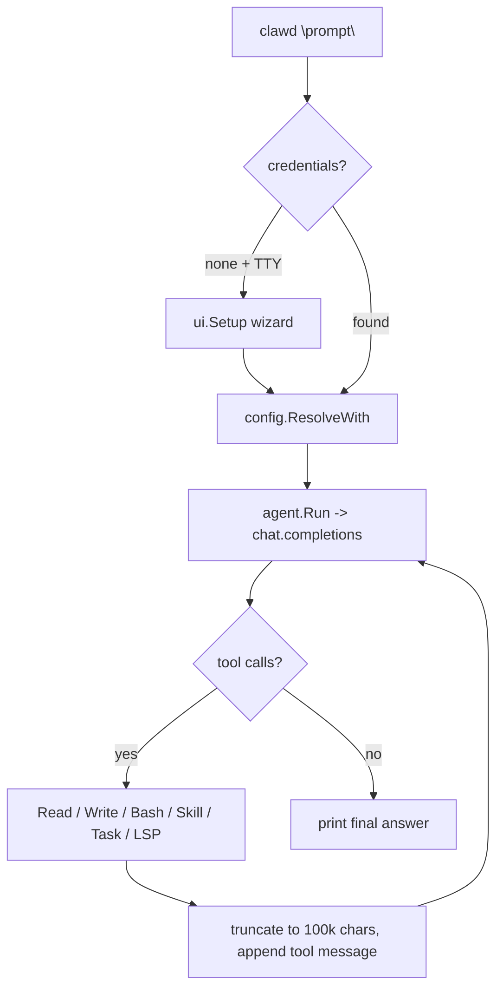

# C-Lawd Code

A small coding agent for the terminal, written in Go. It sends your prompt to an
OpenAI-compatible chat API and lets the model read files, write files, and run
shell commands until the task is done.

It is a single binary, one prompt per invocation, no daemon, no session server.

```
$ clawd "find the failing test in internal/config and fix it"
```

## Install

All three paths install the same binary (`clawd`).

```sh
# npm — Node 18+, no build step
npm install -g clawd-code

# curl — Linux and macOS, verifies the release checksum
curl -fsSL https://raw.githubusercontent.com/Barmanji/ClaudeCode/main/install.sh | sh

# Go
go install github.com/Barmanji/ClaudeCode/cmd/clawd@latest
```

From a checkout: `go build -o clawd ./cmd/clawd`.

## First run

`clawd setup` is the configuration wizard. It runs automatically the first time
you execute a prompt without credentials.

1. Pick a provider (OpenRouter, OpenAI, Groq, DeepSeek, Mistral, xAI, Together,
   Ollama, or a custom OpenAI-compatible URL).
2. Paste the API key. Keys are validated against the provider before anything is
   saved.
3. Pick a model from the provider's live `/models` catalogue, or type any model ID.

The result lands in `clawd-code/config.json` inside your OS config directory
(`~/.config/clawd-code/config.json` on Linux), with `0600` permissions.

If you already have a key exported, you can skip setup entirely — the agent
detects it on first run:

```sh
OPENAI_API_KEY=sk-... clawd "explain what internal/agent does"
```

The wizard is interactive only. For CI or containers, avoid it:

```sh
clawd setup --no-input --provider openai --model gpt-4o-mini
# reads OPENAI_API_KEY from the environment
```

## Usage

```sh
clawd -p "explain this repo"                 # explicit prompt
echo "summarise README.md" | clawd           # piped prompt
clawd --model gpt-4o "refactor executeBash"  # one-off model override
clawd --verbose "add a --dry-run flag"       # prints token usage
clawd models                                 # models your key can use
clawd config                                 # provider, model, masked key, source
clawd config path                            # config file location
clawd config clear                           # delete stored credentials
```

Providers and keys:

| Provider   | Key variable          | Default base URL                  |
| ---------- | --------------------- | --------------------------------- |
| OpenRouter | `OPENROUTER_API_KEY`  | `https://openrouter.ai/api/v1`    |
| OpenAI     | `OPENAI_API_KEY`      | `https://api.openai.com/v1`       |
| Groq       | `GROQ_API_KEY`        | `https://api.groq.com/openai/v1`  |
| DeepSeek   | `DEEPSEEK_API_KEY`    | `https://api.deepseek.com/v1`     |
| Mistral    | `MISTRAL_API_KEY`     | `https://api.mistral.ai/v1`       |
| xAI        | `XAI_API_KEY`         | `https://api.x.ai/v1`             |
| Together   | `TOGETHER_API_KEY`    | `https://api.together.xyz/v1`     |
| Ollama     | none                  | `http://localhost:11434/v1`       |

Override anything with `CLAWD_API_KEY`, `CLAWD_PROVIDER`, `CLAWD_MODEL`,
`CLAWD_BASE_URL`, or `CLAWD_MAX_TOKENS`. Precedence is flags, then `CLAWD_*`,
then the provider's own key variable, then the config file.

## Skills

Any directory matching `.claude/skills/<name>/SKILL.md` in the working directory
(or `~/.config/clawd-code/skills/`) is exposed to the model as a `Skill` tool.
Frontmatter supports `name`, `description`, `context: fork`, and `agent`.

```
/review src/main.go
```

expands the `review` skill and substitutes `$ARGUMENTS`, `$0`, `$1`, and so on
before the prompt is sent.

## How it works

`cmd/clawd` resolves configuration, then hands one prompt to `internal/agent`.
The loop is a plain chat-completions conversation with tool results appended
until the model stops calling tools.



Guard rails: 64 tool rounds per prompt, subagents stop at depth 2, and tool
output is truncated before it reaches the model. API errors are translated into
something actionable (`401` tells you to run `clawd setup`).

## Layout

```
cmd/clawd          flags, subcommands, client construction
internal/config    providers, key resolution, validation, config file
internal/ui        first-run wizard (charmbracelet/huh)
internal/agent     tool-calling loop and tool implementations
internal/skills    SKILL.md loading and slash-command expansion
internal/lsp       optional LSP bridge client
```

## Limitations

- One prompt per process; there is no persistent session or streaming output.
- `Task` and `Skill` subagents share the parent model and cannot use the `Skill`
  or `Task` tools themselves.
- The `LSP` tool only works when a CodeCrafters LSP bridge is available through
  `CODECRAFTERS_LSP_URL`. Without it the tool is not offered to the model.
- The `Bash` tool runs `bash -c` (falling back to `sh -c`) on Unix and `cmd /C` on
  Windows. Set `CLAWD_SHELL` to override the shell binary.

## Contributing

Issues and PRs are welcome. `go test ./...` and `go vet ./...` must pass;
`internal/config`, `internal/skills`, and `cmd/clawd` have unit tests.

## Releasing

Versions are cut with a tag. CI builds the five platform binaries, publishes the
GitHub release, and then publishes the npm launcher plus one package per
platform.

```sh
git tag v0.1.0 && git push origin v0.1.0
```

The only secret needed is `NPM_TOKEN` (an npm automation token) in the repository
settings; `GITHUB_TOKEN` is provided by Actions. To publish by hand after a
release exists: `NPM_PUBLISH_DRY_RUN=1 ./scripts/publish-npm.sh 0.1.0`.

## License

MIT — see [LICENSE](https://github.com/Barmanji/ClaudeCode/blob/main/LICENSE).
